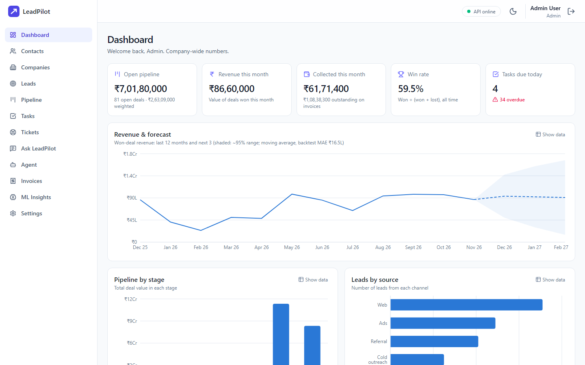
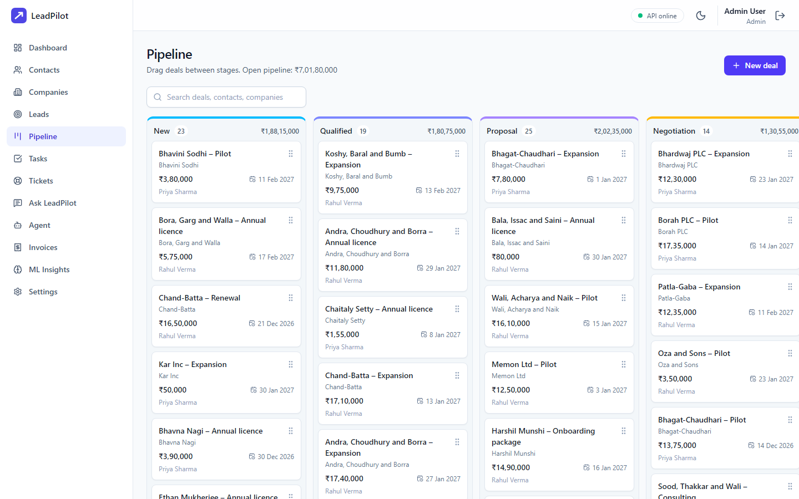
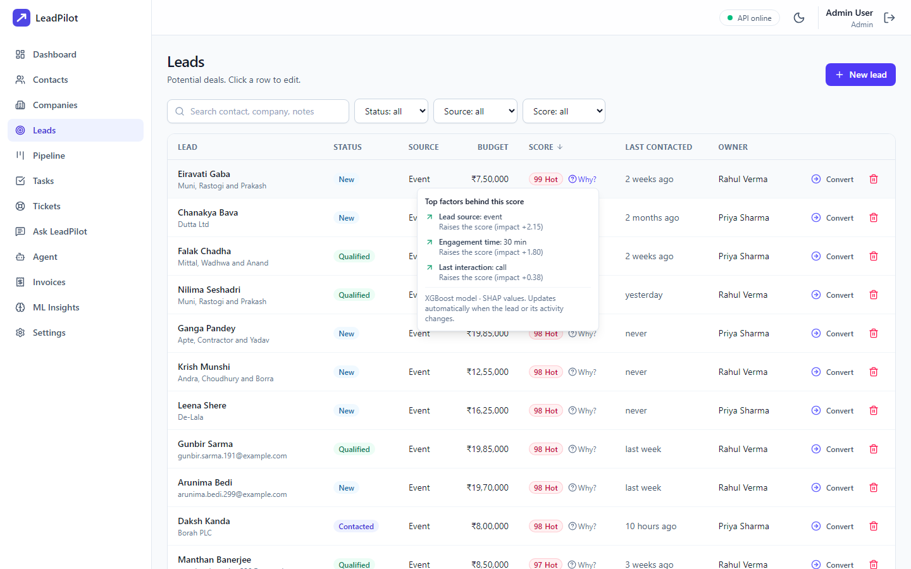
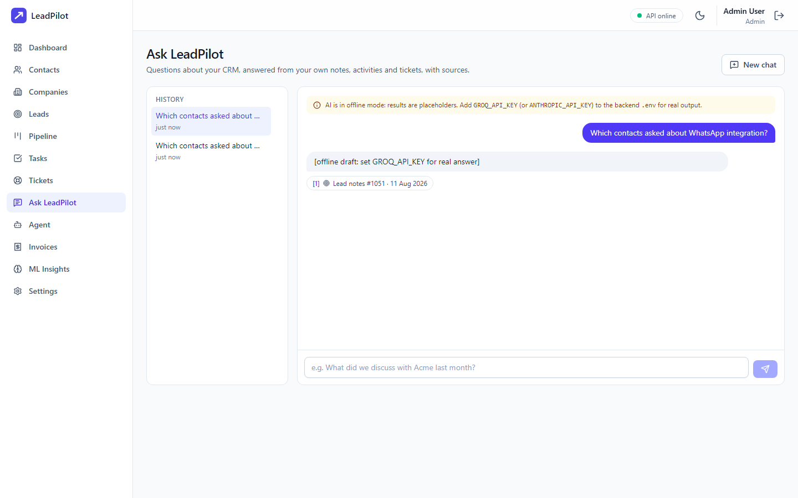
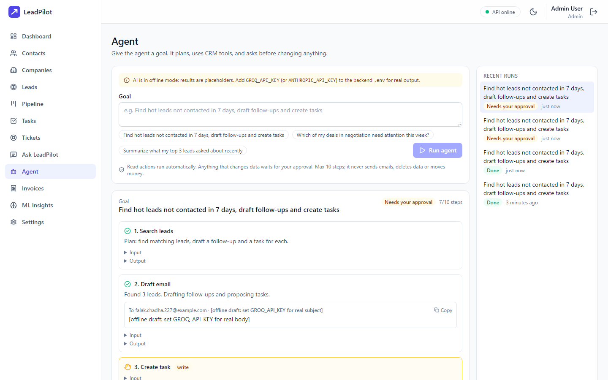
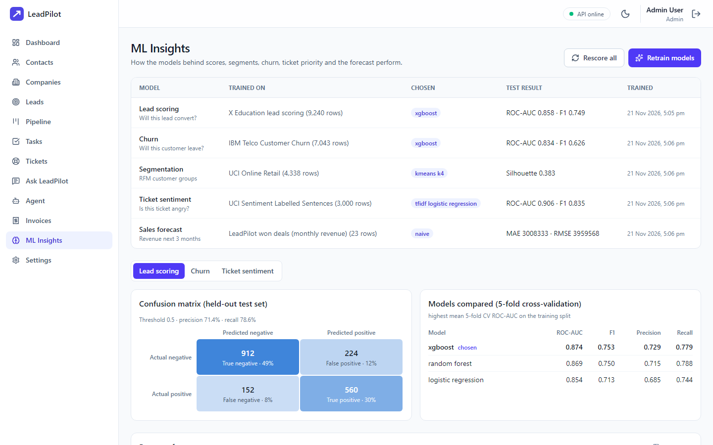
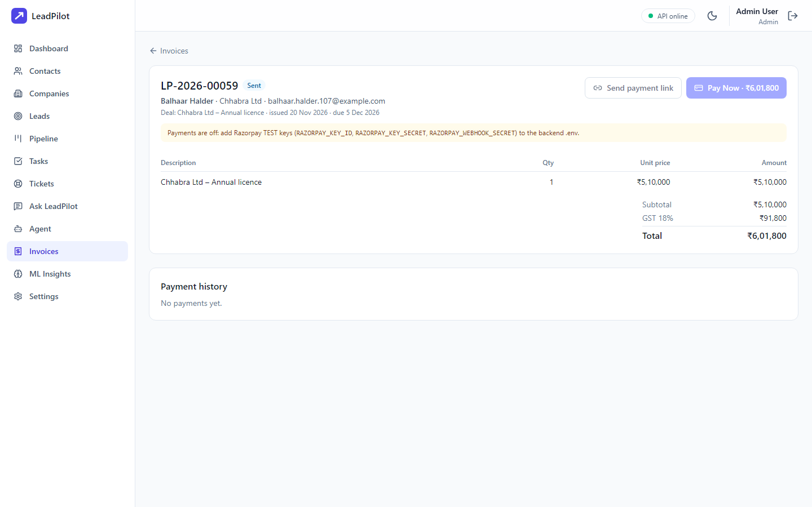
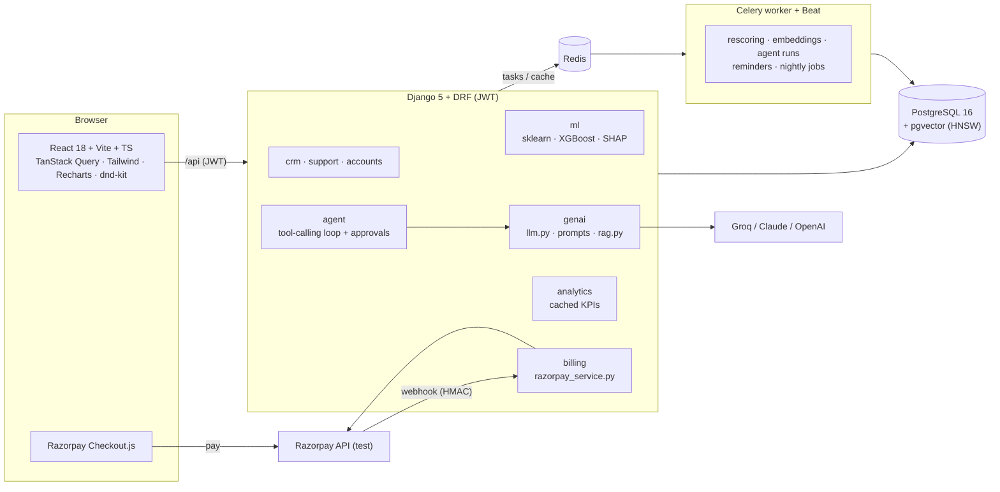

# LeadPilot

**An AI-powered CRM for small businesses.** Django + React, with machine-learning lead
scoring, churn and segmentation, a revenue forecast, AI email drafting and summaries,
"Ask LeadPilot" search over your own notes (RAG with citations), a tool-calling agent that
asks before it changes anything, and Razorpay payments (test mode).



| | |
| --- | --- |
|  |  |
|  |  |
|  |  |

## Features

1. **Contacts, companies & leads**: search, filters, CSV import with per-row errors,
   activity timeline, role-based access (Admin / Sales Rep / Support).
2. **Deal pipeline**: drag-and-drop Kanban with live column totals; tasks with daily
   overdue reminders (Celery Beat).
3. **AI lead scoring**: XGBoost probability → 0-100 score with a "Why?" popover of the top
   SHAP factors; rescored automatically when a lead or its activity changes.
4. **Segmentation & churn**: K-Means on RFM (Champions / Loyal / At Risk / Lost) and a churn
   classifier on every customer.
5. **Sales forecast**: next 3 months of revenue with a ~95% band, chosen by backtest.
6. **Smart tickets**: TF-IDF sentiment + urgency → automatic priority.
7. **AI writer**: follow-up emails from a contact's real history; activity summaries with
   action items → tasks.
8. **Ask LeadPilot (RAG)**: questions answered only from your CRM records, with clickable
   citations; "I don't know" when the records don't say.
9. **Agent**: give it a goal; it plans, uses CRM tools, and pauses for your approval on any
   change (max 10 steps, no deletes, no money movement).
10. **Invoicing & Razorpay**: invoice a won deal (GST 18%), Pay Now or payment link; the signed
    webhook marks it paid, wins the deal and updates the dashboard.

## Architecture



**One lead becomes revenue:** a lead is captured (form/CSV) → the ML model scores it →
the agent drafts a follow-up and you approve the task → the deal moves to Won on the Kanban →
an invoice is created → the customer pays with Razorpay → the signed webhook marks the invoice
paid, logs "Payment received" and refreshes the dashboard → that revenue feeds churn,
segmentation and the forecast.

## Quick start

**Docker (recommended)**: Docker Desktop, then

```bash
cp .env.example .env
docker compose up --build        # postgres(pgvector), redis, backend, celery, beat, frontend
docker compose exec backend python manage.py seed_demo
```

**Without Docker**: Python 3.11+, Node 22+. With no `DATABASE_URL` the backend uses SQLite
(RAG falls back to NumPy search), and Celery tasks run inline when there's no Redis.

```bash
cd backend
python -m venv .venv && .venv\Scripts\activate     # macOS/Linux: source .venv/bin/activate
pip install -r requirements-dev.txt -r requirements-embeddings.txt
python manage.py migrate && python manage.py seed_demo
python manage.py runserver                          # http://localhost:8000

cd ../frontend && npm install && npm run dev        # http://localhost:5173
```

| What | URL |
| --- | --- |
| App | http://localhost:5173 |
| Swagger / OpenAPI | http://localhost:8000/api/docs/ |
| Health | http://localhost:8000/api/health/ |
| Django admin | http://localhost:8000/admin/ |

### Demo logins (password `LeadPilot@123`)

| Username | Role | Sees |
| --- | --- | --- |
| `admin` | Admin | Everything, all reps' data, retraining, refunds |
| `priya` | Sales Rep | Her own companies, contacts, leads, deals, invoices; the agent |
| `rahul` | Sales Rep | His own records |
| `sneha` | Support | Ticket queue + read-only contacts |

`seed_demo` creates 50 companies, 300 contacts, 400 leads, 150 pipeline deals plus 240 closed
deals of 24-month history, 500 realistic activity notes, 120 tasks, 80 tickets and invoices
for recent won deals, then scores leads, segments customers and builds the search index.

AI features work offline with placeholders; add `GROQ_API_KEY` (or `ANTHROPIC_API_KEY`) to
`.env` for real output. Payments need Razorpay **test** keys (see below).

## Tech stack

| Layer | Tech |
| --- | --- |
| Backend | Python 3.11, Django 5, Django REST Framework, SimpleJWT, django-filter, drf-spectacular |
| Data | PostgreSQL 16 + pgvector, Redis |
| Async | Celery + Celery Beat |
| ML | pandas, scikit-learn, XGBoost, imbalanced-learn, SHAP, joblib |
| GenAI | Groq (OpenAI-compatible) / Claude via official SDK, Pydantic, sentence-transformers |
| Payments | Razorpay Python SDK + Checkout.js (test mode) |
| Frontend | React 18, Vite, TypeScript, Tailwind CSS, React Router, TanStack Query, React Hook Form + Zod, Recharts, @dnd-kit |
| Quality | pytest (+ coverage), Vitest, Playwright, ruff, black, ESLint, Prettier, pre-commit, GitHub Actions |

## Machine learning results

Five models, each explored in a notebook (`backend/ml/notebooks/`, executed with outputs)
and shipped as a pipeline (`backend/ml/pipelines/`). Models + metrics JSON are committed in
`backend/ml/models/` (all < 120 KB).

| Model | Trained on | Chosen (by 5-fold CV) | Held-out test |
| --- | --- | --- | --- |
| Lead scoring | X Education leads (9,240) | XGBoost (vs LR, RF) | ROC-AUC **0.858** · F1 0.749 |
| Churn | IBM Telco (7,043) | XGBoost (vs LR, RF) | ROC-AUC **0.834** · recall 0.80 |
| Segmentation | UCI Online Retail (4,338 customers) | K-Means k=4 on RFM percentiles | silhouette **0.383** |
| Ticket sentiment | UCI labelled sentences (3,000) | TF-IDF + LR (vs Naive Bayes) | ROC-AUC **0.906** · F1 0.835 |
| Forecast | LeadPilot won deals by month | best of 3 regressions + 2 baselines, 9-month backtest | shown on ML Insights |

Public datasets have different columns than a CRM, so each model trains on a small **shared
feature space** that `ml/features.py` also computes from LeadPilot records (money and counts as
within-dataset percentiles). A missing model never breaks the CRM: fields stay empty, the API
returns 503.

```bash
python manage.py ml_download_data      # public datasets -> ml/data/raw (gitignored)
python manage.py ml_train              # train all (or: ml_train lead_score churn ...)
python ml/notebooks/run_notebooks.py   # execute every notebook top to bottom
```

## Generative AI, RAG and the agent

- One wrapper for every LLM call: `genai/llm.py` → `chat(messages, tools=None,
  json_schema=None)` with timeouts, retries + backoff, and a token log (`LLMCall`). Providers:
  Groq (default), Claude (official Anthropic SDK, `claude-opus-5-5`), OpenAI, offline mock.
- Prompts are files (`genai/prompts/`); JSON is validated with Pydantic and retried once, then
  fails cleanly (502). CRM text is fenced as untrusted data (prompt-injection tested).
- **RAG**: ~500-char chunks (50 overlap) → `all-MiniLM-L6-v2` (384-d) → pgvector + HNSW cosine;
  role-scoped search, company/contact + date-phrase filters, top-5, similarity threshold →
  "I don't know"; answers cite `[{type, id, snippet}]`. `manage.py reindex_all` rebuilds.
- **Agent**: read tools (`search_leads`, `get_contact_history`, `draft_email`, `ask_crm`) run
  automatically; write tools (`create_task`, `update_deal_stage`, `create_invoice`,
  `create_payment_link`) wait for Approve/Reject; 10-step limit; every step logged.
- Rate limits: 20 AI requests/min per user; 10 login attempts/min per IP.

## Payments: Razorpay test mode

Flow: create order → Checkout.js → backend verifies the payment signature ("processing") →
**the webhook is the source of truth** (`payment.captured`, `payment_link.paid`,
`payment.failed`): `X-Razorpay-Signature` verified (constant-time HMAC), event stored in
`WebhookEvent` (duplicates skipped) → invoice paid, deal Won, "Payment received" activity,
dashboard refreshed. Amounts are Decimal rupees in the DB and paise for Razorpay
(₹499.50 → 49950). The key secret never reaches the browser; live keys are refused.

1. Razorpay → **Test Mode** → Settings → API Keys → put `RAZORPAY_KEY_ID=rzp_test_…` and
   `RAZORPAY_KEY_SECRET` in `.env`.
2. `ngrok http 8000`, then Razorpay → Settings → Webhooks →
   `https://<id>.ngrok-free.app/api/billing/webhook/` with `payment.captured`,
   `payment.failed`, `payment_link.paid` and a secret → `RAZORPAY_WEBHOOK_SECRET`.
3. Pay an invoice with test card `4111 1111 1111 1111` (any future date, any CVV).

## Tests

| Suite | Command | Status |
| --- | --- | --- |
| Backend (pytest, mocked LLM + Razorpay) | `cd backend && pytest --cov` | 300 tests, **89%** coverage (CI requires ≥ 70%) |
| Frontend (Vitest + Testing Library) | `cd frontend && npm test` | 42 tests |
| End-to-end (Playwright) | `cd frontend && npm run e2e` | login · lead → score · deal → Won → invoice → paid · agent approval · RAG question |
| Security sweep | part of pytest | every API operation checked for auth + role rules |

Detailed scenarios: **[docs/TEST_CASES.md](docs/TEST_CASES.md)**. CI (GitHub Actions) runs
lint, migration check, Django `check --deploy`, backend tests on Postgres + pgvector, frontend
tests and build, then the Playwright suite.

## Deploy

Render (API, worker + Beat, Postgres with pgvector, Redis) via `render.yaml`, and Vercel for
the frontend: **[docs/DEPLOY.md](docs/DEPLOY.md)**.

## API

Interactive docs at `/api/docs/`. Main groups: `/api/auth/` (login, refresh, me, register,
users) · `/api/crm/` (companies, contacts + CSV import, leads + convert, deals + board/move,
activities, tasks) · `/api/support/tickets/` · `/api/analytics/summary/` · `/api/ml/`
(score-lead, metrics, forecast, segments, retrain, rescore-all, classify-ticket) ·
`/api/genai/` (draft-email, summarize-activity, action-items-to-tasks, ask, conversations,
status, usage) · `/api/agent/` (runs, steps approve/reject) · `/api/billing/` (invoices +
create-order/payment-link, verify, webhook, refund, config).

## Project layout

```
backend/
  config/      settings (base/dev/test/e2e/prod), urls, celery
  accounts/    custom User with roles, JWT auth
  crm/         companies, contacts, leads, deals, activities, tasks, seed_demo
  support/     tickets + comments (auto sentiment/priority)
  ml/          notebooks/, pipelines/, models/, features.py, services.py
  genai/       llm.py, prompts/, embeddings.py, rag.py
  agent/       tools.py, agent.py (approval loop)
  billing/     invoices, payments, webhooks, razorpay_service.py
  analytics/   dashboard KPIs
  common/      permissions, base models, error format
frontend/
  src/         api/ components/ features/<module>/ hooks/ layouts/ pages/ routes/ types/
  e2e/         Playwright flows + screenshot capture
docs/          DEPLOY.md, TEST_CASES.md, screenshots/
```

The full build spec is in [CLAUDE.md](CLAUDE.md).
